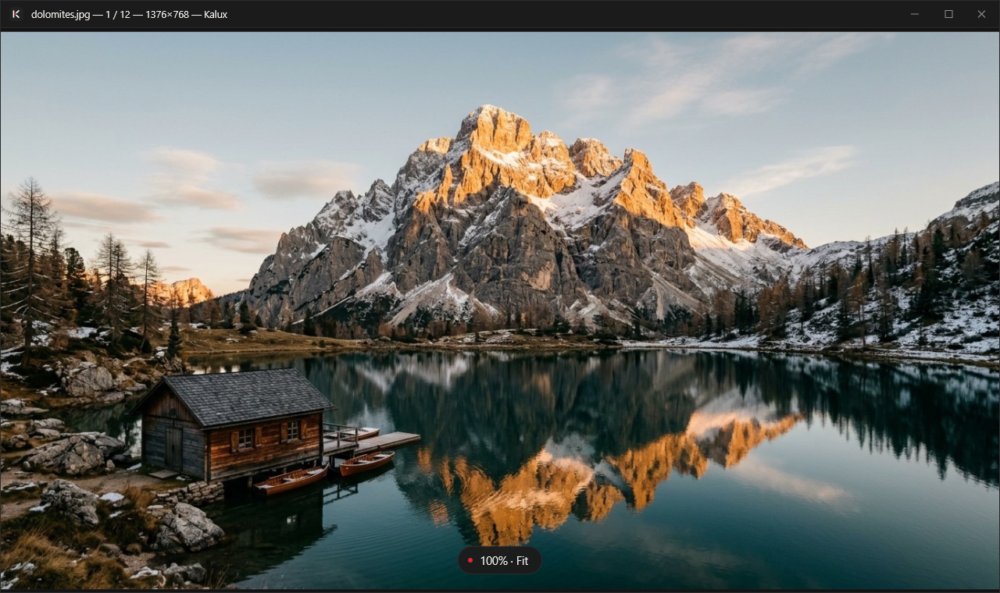
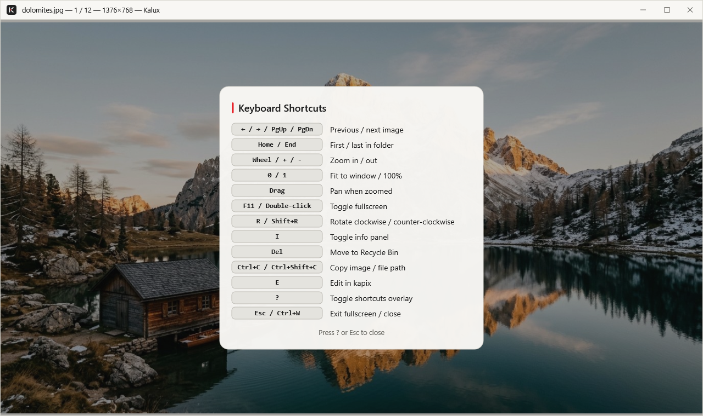

<p align="center">
  
</p>

<p align="center">
  
  
  
  
  <a href="LICENSE"></a>
</p>

<p align="center">
  <a href="#screenshots">Screenshots</a> ·
  <a href="#footprint">Footprint</a> ·
  <a href="#shortcuts">Shortcuts</a> ·
  <a href="#cli">CLI</a> ·
  <a href="#building">Building</a> ·
  <a href="docs/PRD.md">PRD</a> ·
  <a href="#license">License</a>
</p>

---

Instant native image viewer for Windows — 100% pure Rust, one portable `.exe`, zero bloat. A fast replacement for the Windows 11 Photos app for the thing you actually do: open an image and flip to the next one.

Kalux = **Ka**rel + **lux** (Latin for light). Same family as [Kavox](https://github.com/Aitemaa/Kavox), [Kadex](https://github.com/Aitemaa/Kadex) and [Kapix](https://github.com/Aitemaa/Kapix): the same tokens, neutral surfaces and one red accent, with light/dark following Windows.

- **Decode overlaps window creation:** the opened file starts decoding before Win32/Direct2D finishes initializing; folder listing and neighbor preloading (`N±2`) run only after the first frame is on screen.
- **Native Windows stack:** raw Win32, Direct2D (`HIGH_QUALITY_CUBIC` / `LINEAR` / `NEAREST_NEIGHBOR`), lazy DirectWrite overlays, WIC + `zune-jpeg` decoding, per-monitor DPI v2, and Mica chrome.
- **~647 KB single executable:** no WebView2, no .NET, no WinUI 3, no background processes after close, zero idle CPU, no telemetry.

Full requirements: [docs/PRD.md](docs/PRD.md).

## Screenshots

<p align="center">
  
</p>

<p align="center">
  
</p>

<sub>Rendered offscreen by Kalux's own Direct2D + DirectWrite code (<code>kalux.exe --screenshot assets/demo-photo.jpg ...</code>).</sub>

## Footprint

First measurements from GitHub Actions (`windows-latest`, software WARP renderer, 12 MP 4000×3000 JPEG) alongside Windows 11 Photos typical ranges and PRD targets:

| Metric | Windows Photos (est.) | **Kalux (CI VM)** | PRD target (bare-metal) |
| :--- | :--- | :--- | :--- |
| **Release binary** | 150–400 MB install | **0.62 MiB** (647 KB) | ≤ 4.0 MiB |
| **Private RAM (12 MP open)** | 150–350 MB | **23.6 MB** *(41.5 MB WS)* | ≤ 50 MB |
| **Start → first present** | 1.5–4.0 s | **~204 ms** *(WARP VM)* | ≤ 150 ms |
| **Next / previous (preloaded)** | 100–400 ms | **1 frame** *(cache hit)* | ≤ 16 ms |
| **Idle CPU / after close** | background process | **0% / 0 processes** | 0% / 0 |

## Shortcuts

| Key | Action |
| :--- | :--- |
| `←` `→` / `PgUp` `PgDn` / Mouse 4–5 | Previous / next image in folder (natural sort) |
| `Home` / `End` | First / last image |
| Wheel, `+` `-` | Zoom (anchored at cursor; high-res wheel supported) |
| `0` / `1` | Fit to window / 100% actual pixels |
| Left-drag | Pan when zoomed in |
| `F11`, double-click | Fullscreen |
| `?` | Keyboard shortcuts overlay |
| `Esc` / `Ctrl+W` | Exit fullscreen, then close |

## CLI

```powershell
kalux.exe path\to\photo.jpg                                  # open an image
kalux.exe --version                                          # print version
kalux.exe --bench-startup photo.jpg [--bench-out out.jsonl]  # JSON startup + RAM timings
kalux.exe --gen-test-image test.jpg 4000 3000                # deterministic 12 MP test JPEG via WIC
kalux.exe --screenshot photo.jpg out.png [--light] [--help]  # offscreen Direct2D PNG render
```

## Building

Requires Rust 1.88+ (edition 2024) on Windows:

```powershell
cargo build --release -p kalux-app   # → target\release\kalux.exe
cargo test --workspace
```

On Linux, the platform-independent crates and Windows type-check run cleanly:

```bash
cargo test -p kalux-core -p kalux-decode
cargo clippy --workspace --all-targets --target x86_64-pc-windows-msvc -- -D warnings
```

## License

MIT — see [LICENSE](LICENSE).
