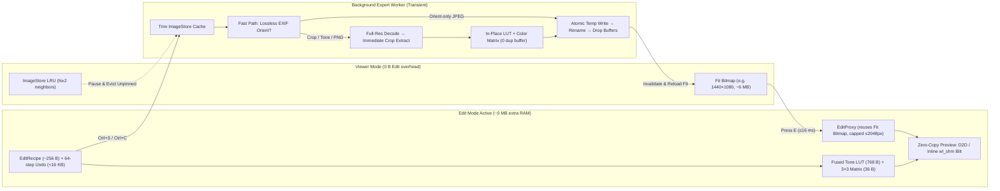

# Kalux Edit Mode: Product Requirements Document

| | |
|---|---|
| **Feature** | In-App Edit Mode (Crop, Transform & Simple Adjustments) |
| **Product** | Kalux — fast native image viewer for Windows and Linux (Wayland) |
| **Family** | ka-suite: kavox (voice), kadex (notes), kapix (snipping & annotation), **kalux (photos)** |
| **Parent PRD** | [docs/PRD.md](PRD.md) |
| **Owner** | Ignatius Karel |
| **Status** | v0.2 (UX Decisions Locked) |
| **Date** | 2026-11-25 |
| **Target Release** | v0.3 |
| **Language** | 100% Pure Rust (zero new C/C++ or external heavy dependencies) |

---

## 1. Summary

**Edit Mode** lets a user press `E` (or `C` for immediate crop) right after opening an image in Kalux to **crop, rotate, flip, straighten, and apply quick tone/color adjustments**, then save or copy the result — without leaving Kalux or paying the memory and startup tax of a full image editor.

The core engineering constraint is **low RAM at every stage**: interactive editing operates non-destructively on the already-decoded viewport proxy bitmap with a ~256-byte parametric recipe and a `< 16 KB` undo stack, adding **~0 MB of persistent RAM** over Viewer Mode. Full-resolution pixels are decoded **only during export**, processed in a single memory-bounded pass, and immediately released.

> **Boundary with Kapix:** Kalux Edit Mode handles **photo adjustments** (crop, orient, straighten, basic tone/color, resize-on-export). Drawing annotations (arrows, callout boxes, text, blur/redact boxes, OCR) remains **Kapix's** job, reachable via `Shift+E` (*Annotate in Kapix*). This amends [docs/PRD.md](PRD.md) §3 and §7.4 cleanly without bloating either app.

---

## 2. Problem & Motivation

Today, Kalux opens a 12 MP JPEG in ~37–220 ms using only **13.4 MB** (Linux) / **23.6 MB** (Windows) of private RAM. However, the most common follow-up action after inspecting a screenshot or photo is a **5-second quick edit**:

- Trimming excess margins from a photo or screenshot before sharing
- Straightening a slightly tilted horizon or flipping a mirrored webcam image
- Lifting exposure/contrast on an underexposed photo or converting it to monochrome
- Copying a cropped region straight to the clipboard without creating temporary files

Opening Windows Photos Editor, Paint, GIMP, or a web editor for these tasks breaks flow and consumes **300–900 MB of RAM**. Yet naive in-app editors suffer from the same four memory traps:

1. **Float32 full-res working buffers:** decoding a 12 MP image to RGBA32F eats **192 MB** before the user moves a single slider.
2. **Bitmap undo stacks:** storing 10 full-resolution undo snapshots multiplies RAM by **480+ MB**.
3. **Stacked caches:** keeping `N±2` preloaded viewer neighbors alive alongside edit buffers doubles peak RAM.
4. **Multi-buffer export pipelines:** allocating separate full-res copies for decode → rotate → crop → color-adjust → encode causes **3×–5× RAM spikes** on save.

Kalux Edit Mode is architected from day one to eliminate all four.

---

## 3. Goals and Non-Goals

### Goals
1. **Zero viewer regression:** when Edit Mode is not opened, cold start, RAM, idle CPU, and navigation latency remain **100% identical** to [docs/PRD.md](PRD.md) §5.
2. **Near-zero interactive RAM overhead:** entering Edit Mode and adjusting crop/sliders keeps private RAM within **≤ 55 MB** (12 MP JPEG) — practically the same as Viewer Mode.
3. **60–144 fps live feedback:** dragging crop handles or moving exposure/contrast sliders renders in **≤ 16 ms** on both Windows (Direct2D) and Linux (Wayland `wl_shm`).
4. **Full-resolution, non-destructive output:** edits are always rendered against the original full-resolution file on Save/Copy — never upscaling or re-saving the downscaled preview proxy.
5. **Safe-by-default file writes:** atomic temp-file-and-rename writes prevent corruption; clear separation between **Save Copy** and **Overwrite Original**.
6. **Zero new heavy dependencies:** reuse existing pure-Rust crates (`png`, `jpeg-encoder`, `image`, `image-webp`) on Linux and native WIC (`IWICBitmapEncoder`) on Windows; `kalux-core` stays **zero-dependency**.

### Non-Goals
- **Layers, masks, brushes, lasso/magic-wand selections, healing/clone tools**
- **AI editing** (background removal, generative erase, super-resolution)
- **RAW demosaicing / 16-bit HDR grading / curves / split-toning**
- **Annotations & redaction** (arrows, shapes, text overlays, mosaic blur, OCR) — handed off to **Kapix** (`Shift+E`)
- **Frame-by-frame animated GIF/WebP editing** (Edit Mode on animated images operates on the currently paused frame and exports as a static copy; overwrite is disabled)
- **External C/C++ libraries or GPU shader frameworks** (`wgpu`, `skia`, `opencv`, `libvips` remain forbidden in CI)

---

## 4. Performance & Memory Budgets (Release Blockers)

Reference workload: **12 MP JPEG (4000×3000)** on Windows 11 (x64) and Linux Wayland (CachyOS + Niri), compared against Kalux's measured v0.1 Viewer Mode baseline ([README.md](../README.md)).

| Metric | Kalux Viewer Baseline (measured) | **Edit Mode Target** | **Hard Limit (CI / Release Blocker)** |
| :--- | :--- | :--- | :--- |
| **Viewer Mode cold start / RAM (Edit unused)** | 13.4 MB Linux · 23.6 MB Win | **+0 ms / +0 MB** | ≤ +2% variance |
| **Enter Edit Mode latency (`E` → interactive)** | — | **≤ 16 ms** (1 frame, zero re-decode) | ≤ 33 ms |
| **Private RAM — Edit Mode active (12 MP)** | 13.4 MB Linux · 23.6 MB Win | **≤ 45 MB Linux · ≤ 55 MB Win** | **≤ 80 MB** |
| **Undo stack RAM (64 edit steps)** | — | **≤ 16 KB** | ≤ 64 KB |
| **Crop drag / slider scrub frame time** | — | **≤ 8 ms** (120 fps capable) | **≤ 16 ms** (60 fps) |
| **Transient peak RAM during 12 MP Export** | — | **≤ 110 MB** | **≤ 160 MB** |
| **Export time (12 MP JPEG crop + tone)** | — | **≤ 350 ms** | ≤ 800 ms |
| **Lossless 90° rotate/flip save (JPEG)** | — | **≤ 15 ms / +2 MB** | ≤ 50 ms / +8 MB |
| **Post-export settled RAM (returned to Viewer)** | 13.4 MB Linux · 23.6 MB Win | **≤ 40 MB** (export buffers dropped) | **≤ 55 MB** |
| **Release binary size delta** | 0.62 MiB Win · 1.84 MiB Linux | **≤ +180 KB** | Total ≤ 4.0 MiB target (8.0 MiB CI cap) |
| **Idle CPU in Edit Mode** | 0% | **0%** (event-driven, no render loop) | < 0.5% |

> **Hard rule:** All temporary full-resolution export buffers **must** be dropped before returning to Viewer Mode. No full-resolution pixel buffer may remain resident while scrubbing sliders or idling in Edit Mode.

---

## 5. Low-RAM Edit Architecture

The entire Edit Mode design rests on five memory invariants.



### 5.1 Parametric Non-Destructive Recipe (`EditRecipe`)

All edits are stored purely as lightweight parameters in `kalux-core` — **never** as mutated pixels:

```rust
/// Normalized [0.0..=1.0] rectangle in oriented image space.
#[derive(Copy, Clone, Debug, PartialEq)]
pub struct CropRect {
    pub x: f32,
    pub y: f32,
    pub w: f32,
    pub h: f32,
}

#[derive(Copy, Clone, Debug, Default, PartialEq, Eq)]
pub enum QuarterTurns { #[default] R0, R90, R180, R270 }

#[derive(Copy, Clone, Debug, Default, PartialEq)]
pub struct ToneAdjustments {
    pub exposure: f32,    // -1.0 ..= +1.0  (maps to ±2.0 EV)
    pub contrast: f32,    // -1.0 ..= +1.0
    pub saturation: f32,  // -1.0 ..= +1.0  (-1.0 = grayscale)
    pub warmth: f32,      // -1.0 ..= +1.0  (cool blue ↔ warm amber)
    pub monochrome: bool,
}

#[derive(Copy, Clone, Debug, Default, PartialEq)]
pub struct EditRecipe {
    pub crop: CropRect,              // default: (0.0, 0.0, 1.0, 1.0)
    pub turns: QuarterTurns,
    pub flip_h: bool,
    pub flip_v: bool,
    pub straighten_deg: f32,         // P1: -45.0 ..= +45.0
    pub tone: ToneAdjustments,
    pub export_max_dim: Option<(u32, u32)>, // P1: optional resize-on-export
}
```

- **Size of `EditRecipe`:** ~56 bytes (`Copy`, zero heap allocations).
- **Undo / Redo stack:** `Vec<EditRecipe>` capped at 64 entries = **~3.6 KB** total (plus coalescing continuous drags/slider scrubs so dragging a handle produces 1 undo step on pointer-up, not 200).
- **Resolution independence:** because `CropRect` is normalized `[0.0..1.0]`, a crop drawn on a `1440×1080` preview proxy maps deterministically to exact integer source pixels `(src_x, src_y, src_w, src_h)` on the `4000×3000` original during export.

### 5.2 Proxy-Buffer Strategy & Cache Coordination

- **Reuse the Viewer bitmap:** When the user presses `E`, Kalux already holds an `Arc<DecodedImage>` decoded to fit the client window (`width × height`, typically `1440×1080` = 6.2 MB on 1080p, or `≤ 2048 px` on the long edge = **≤ 16 MB max**). Edit Mode uses this exact `Arc<DecodedImage>` directly as its read-only `EditProxy`.
- **No full-res decode on zoom-in while editing (optional cap):** If the user zooms slightly to fine-tune a crop edge, Edit Mode caps proxy upgrades at `2048 px` long edge unless the source itself is smaller — preventing a 48 MB–192 MB RAM jump just for lining up a crop handle.
- **Pause preloading & trim neighbors:** Entering Edit Mode calls `ImageStore::enter_edit_mode(&current_path)`, which:
  1. Drops all queued neighbor decode jobs.
  2. Unpins `N±2` neighbors and trims the LRU cache to keep **only** the active image's proxy (immediately freeing 20–100 MB if the user was browsing a folder first).
  3. On exiting Edit Mode, normal `focus(current, neighbors, target)` resumes seamlessly.

### 5.3 Zero-Copy Real-Time Preview Rendering

Both platform renderers apply geometric + color edits without allocating a duplicate pixel buffer:

- **Precomputed fused color operator (`ToneLut`, < 1 KB in `kalux-core`):**
  - Exposure + Contrast are folded into a single `[u8; 256]` sRGB-aware transfer table (256 bytes) — or `[u8; 256]` per channel `[R, G, B]` (768 bytes) when Warmth is active.
  - Saturation / Monochrome is folded into a single 3×3 luminance-preserving matrix (`[f32; 9]` = 36 bytes, Rec.709 weights `0.2126, 0.7152, 0.0722`).
  - When `ToneAdjustments::is_identity()` is true (e.g. pure crop/rotate), the color pass is completely bypassed (0 CPU cost).
- **Linux Wayland (`wl_shm` software renderer — `crates/kalux-app/src/linux/render.rs`):**
  - `Canvas::blit_image` already maps destination viewport pixels back to source proxy coordinates and writes straight into the double-buffered `wl_shm` `memfd`.
  - Adding orientation mapping (90° turns + flip) and inline `ToneLut` + 3×3 matrix evaluation inside the visible-rect blit loop allocates **0 bytes of extra RAM** and evaluates only visible screen pixels (at most ~2M pixels on 1080p → **~3–6 ms** in `--release`).
  - Crop scrim (dimming pixels outside the crop rectangle) and rule-of-thirds/handle chrome are drawn directly onto the `wl_shm` canvas with existing `fill_rect` / `fill_rounded_rect` primitives.
- **Windows (Direct2D — `crates/kalux-app/src/render.rs`):**
  - Geometric transforms (90° rotation, flip, straighten) use `ID2D1RenderTarget::SetTransform` on the existing GPU `ID2D1Bitmap` — **0 bytes extra RAM**.
  - Tone adjustments use Direct2D's built-in GPU `ID2D1Effect` (`CLSID_D2D1ColorMatrix` for exposure/contrast/saturation/warmth/monochrome) via the already-queried `ID2D1DeviceContext` — **0 bytes extra CPU RAM**, hardware-accelerated at 120+ fps. (If `ID2D1DeviceContext` is unavailable on legacy drivers, fall back to a single reusable proxy-sized scratch bitmap uploaded via `CopyFromMemory`, freed immediately upon leaving Edit Mode.)

### 5.4 Memory-Bounded Full-Resolution Export Pipeline

Full-resolution pixels are touched **only** when the user triggers **Save**, **Save Copy**, or **Copy Edited Image**, running on a dedicated background thread so the UI never freezes:

1. **Pre-export RAM trim:** Drop any non-essential cached viewer bitmaps (`ImageStore::clear_non_active()`) before allocating export memory.
2. **Fast Path A — Lossless Orientation-Only Save (JPEG):**
   - If `crop` is full-frame, `straighten == 0`, `tone.is_identity()`, and format is JPEG: rewrite the EXIF Orientation tag (or lossless metadata update) without decoding pixels at all (**~0 MB extra RAM**, **< 15 ms**, zero generation loss).
3. **Standard Path — Single-Pass Full-Res Export (≤ 16 MP images):**
   - Decode full-resolution source **once** (with EXIF orientation applied so coordinates match `EditRecipe`).
   - Compute exact integer crop rectangle `(cx, cy, cw, ch)` in oriented source space (clamped to `≥ 1×1`).
   - **Immediate crop + orient extraction:** allocate **only** the final output buffer (`cw × ch × 3` RGB8 for opaque JPEG, or `cw × ch × 4` RGBA8/BGRA8 for PNG/WebP/alpha), copy/transpose only the pixels inside `CropRect` into it, and **immediately drop** the full-res source buffer (`drop(source)`).
     - Example: cropping a 12 MP (`4000×3000`) photo down to 50% area allocates only `~18 MB` for the output buffer, then immediately frees the 48 MB source before encoding!
   - **In-place tone pass:** apply `ToneLut` + 3×3 matrix **in-place** on the output buffer (0 extra bytes).
   - **Stream to encoder:** encode directly from the output buffer to a temporary file (`<dir>/.<stem>.kalux.tmp`) using:
     - **Windows:** WIC (`IWICBitmapEncoder`: JPEG with `ImageQuality`, PNG, BMP, TIFF, WebP if codec available) — adds **~0 KB** binary size.
     - **Linux:** existing workspace pure-Rust encoders (`jpeg-encoder` for JPEG, `png` for PNG, `image` for BMP/TIFF).
   - **Atomic commit:** `sync_all()` → atomic rename over destination (`MoveFileExW(MOVEFILE_REPLACE_EXISTING)` on Windows, `std::fs::rename` on Linux). On any I/O error, remove `.tmp` and show a non-modal error toast; the original file is untouched.
   - **Immediate cleanup:** drop output buffer before notifying the UI thread; UI thread calls `ImageStore::invalidate(&saved_path)` and reloads the fit-sized preview.
4. **Large-Image Path — Banded / Strip Processing (> 16 MP, P1):**
   - For huge photos (24 MP–100 MP panoramas) where a single full-res decode would exceed the 160 MB hard limit:
   - When the recipe has no 90° transpose/arbitrary rotation (crop + horizontal flip + tone adjustments), stream rows in **256-row bands** (`width × 256 × 4 B` ≈ 4–10 MB per band) directly into the row-streaming PNG/JPEG/WIC encoder.
   - For rotated huge images, tile-decode/transpose in fixed-memory strips (≤ 32 MB working ceiling).

### 5.5 Zero-Cost Viewer Isolation

- `AppState` stores `edit: Option<EditSession>` (`None` during normal viewing).
- No edit UI fonts, Direct2D effects, LUT tables, or encoder structures are constructed until the user explicitly presses `E` or `C`.
- All new pure-Rust edit logic (`EditRecipe`, `CropRect`, `ToneLut`, hit-testing, undo stack, coordinate transforms) lives in `kalux-core` with **zero external crates**.

---

## 6. Functional Requirements

### 6.1 Entering & Exiting Edit Mode (P0)

- **Enter Edit Mode:**
  - Press `E` → enters Edit Mode with the compact floating bottom edit dock visible (active tool: **Crop** by default, showing the crop frame ready to drag).
  - Press `C` → enters Edit Mode directly with the **Crop** frame focused and aspect presets ready.
  - Press `A` (while in Edit Mode) → switches dock tab to **Adjust** (tone/color sliders).
- **Exit Edit Mode:**
  - Press `Esc` or `E`:
    - If **no unsaved edits** (`recipe.is_identity()`): exits immediately back to Viewer Mode in 1 frame.
    - If **unsaved edits exist**: shows a compact inline confirmation pill at the bottom (*"Unsaved edits — [Save Copy] [Discard] [Cancel]"*, keyboard `Enter` / `D` / `Esc`) instead of a blocking OS modal dialog.
- **Navigation lock:** `←` / `→` folder navigation is disabled while in Edit Mode (arrows nudge the crop box instead) so users never accidentally lose edits by bumping an arrow key.
- **Kapix handoff:** `Shift+E` launches **Kapix** with the current image path (or if unsaved edits exist, prompts/exports a temp copy or warns cleanly).

### 6.2 Crop Tool (P0)

- **Interactive crop overlay:**
  - 8 drag targets: 4 corner L-handles (`NW`, `NE`, `SW`, `SE`) + 4 edge midpoint bars (`N`, `S`, `E`, `W`), with generous hit padding (`14 logical px`) and appropriate native cursor shapes (`wp_cursor_shape_v1` on Wayland, `IDC_SIZE*` on Win32).
  - Dragging inside the crop rectangle moves the crop region smoothly, clamped to image bounds.
  - Dragging outside the crop rectangle (when full-frame or starting fresh) draws a new crop box directly.
  - **Rule-of-thirds grid** (`3×3` hairline lines) fades in while actively dragging a handle/box, staying clean when still.
  - **Live dimension badge** attached to the crop corner (e.g., `2400 × 1350 · 16:9`), calculated in **full-resolution source pixels**.
  - **Minimum crop size:** clamped so resulting full-res crop is always `≥ 16 × 16 px` (or full image if source `< 16 px`).
- **Aspect ratio presets:**
  - `Free` (default), `Original`, `1:1`, `4:3`, `3:2`, `16:9`
  - Press `X` to flip preset orientation (e.g., `16:9` ↔ `9:16`, `4:3` ↔ `3:4`).
  - Holding `Shift` during free-crop corner drag temporarily locks the current aspect ratio.
- **Precision keyboard nudging:**
  - `Arrow keys`: move crop box by `1 source px` (`Shift + Arrow`: `10 source px`).
  - `Ctrl + Arrow`: shrink/expand crop from bottom-right edge by `1 px` (`Ctrl + Shift + Arrow`: `10 px`).

### 6.3 Transform Tools (P0 / P1)

- **P0:**
  - **Rotate 90° CW (`R`) / CCW (`Shift+R`):** rotates image and preserves the user's crop box rotated along with the image.
  - **Flip Horizontal (`H`) / Vertical (`V`):** mirrors image and mirrors the crop rectangle symmetrically.
- **P1 (v0.3.1):**
  - **Fine Straighten (`-45.0°` to `+45.0°`):** interactive dial/slider in the Crop tab; overlays a fine alignment grid while dragging and automatically inscribes the largest valid axis-aligned crop rectangle inside the rotated bounds so black corner wedges never appear.

### 6.4 Simple Tone & Color Adjustments (P0)

Four high-impact, intuitive sliders + one toggle — covering 90% of quick photo fixes without clutter:

| Control | Range | Default | Math / Behavior |
| :--- | :--- | :--- | :--- |
| **Exposure** | `-100` .. `+100` | `0` | Linear-light exposure gain $2^{2v}$ (approx. ±2 EV) mapped cleanly to sRGB 8-bit LUT with soft highlight roll-off to avoid harsh clipping |
| **Contrast** | `-100` .. `+100` | `0` | S-curve / midpoint-pivoted contrast around `0.5` luminance folded into the 1D LUT |
| **Saturation** | `-100` .. `+100` | `0` | Rec.709 luminance-preserving 3×3 saturation matrix (`-100` = pure neutral grayscale) |
| **Warmth** | `-100` .. `+100` | `0` | Balanced R/B channel gain shift (warm amber ↔ cool blue) preserving perceived luminance |
| **Monochrome (`M`)** | Off / On | Off | One-click crisp Rec.709 B&W toggle (overrides saturation while preserving exposure/contrast) |

- Double-clicking any slider label or thumb resets **that individual slider** to `0`.
- **Before / After Compare:** Hold `\` (or click-and-hold the eye icon in the dock) to temporarily display the unedited original; release to return immediately.
- **Undo / Redo / Reset:**
  - `Ctrl+Z` undo, `Ctrl+Y` / `Ctrl+Shift+Z` redo (up to 64 steps).
  - `Ctrl+R` (or Reset button) resets all edits back to `EditRecipe::default()` (pushing onto the undo stack so an accidental Reset can be undone with `Ctrl+Z`!).

### 6.5 Save, Save Copy, Clipboard & Format Support (P0 / P1)

| Action | Shortcut | Behavior |
| :--- | :--- | :--- |
| **Save Copy** | `Ctrl+Shift+S` (or primary **Save Copy** dock button) | Saves immediately with zero prompt to `<stem>_edited.<ext>` in the same folder (auto-incrementing `_edited_2`, `_edited_3` if needed so nothing is ever clobbered). Inserts the new file into the active `Playlist` in natural sort order, switches the viewer directly to it (so the user sees their saved crop right away and can press `←` to flip back to the original), exits Edit Mode, and shows toast `"Saved photo_edited.jpg · 2400×1350"`. |
| **Save** | `Ctrl+S` | **Smart non-destructive save:** if edits are **lossless orientation-only** on a JPEG (pure 90° rotate/flip, no crop/tone), saves **immediately in-place** via EXIF tag update. For **pixel edits** (crop / tone / non-JPEG), opens a crisp inline Save bar inside the dock (`[Save Copy (Enter)]` primary red default · `[Overwrite (O)]` atomic replace · `[Cancel (Esc)]`) — preventing accidental destruction of original photos on reflexive `Ctrl+S` while staying 100% keyboard-driven and modal-free. For read-only/unsupported-write formats (`HEIC`, `AVIF`, `JXL`, `GIF`, `ICO`, `WebP` if encoder absent), saves directly as a `.png` (if alpha present) or `.jpg` (if opaque) copy with a clear toast. |
| **Copy Edited Image** | `Ctrl+C` | Runs the export pipeline to an in-memory bitmap and places it on the OS clipboard (Win32 `CF_DIB` / PNG clipboard format; Wayland `wl_data_device` offering `image/png`) without writing anything to disk. Shows toast `"Copied edited image (2400×1350)"`. |
| **Export Options (inline popover, P0/P1)** | Gear / format pill in dock | Choose output format (`Original` / `JPEG` / `PNG`), JPEG quality preset (**`92`** default, with quick chips `80` / `92` / `98`), and P1 **Resize max edge** (`Original` / `1920px` / `1280px` / Custom). |

#### Format Write Support Matrix

| Format | Windows Export Backend | Linux Export Backend | Alpha Preserved? | Metadata / EXIF |
| :--- | :--- | :--- | :--- | :--- |
| **JPEG** | WIC `CLSID_WICJpegEncoder` (default Q=92) | `jpeg-encoder` (already in `Cargo.toml`, default Q=92) | No (composited over solid bg) | Orientation normalized to `1`; lossless EXIF rotate fast-path when orient-only |
| **PNG** | WIC `CLSID_WICPngEncoder` | `png` crate (already in `Cargo.toml`) | Yes (unpremultiplied cleanly on encode) | Strip orientation tag (pixels baked) |
| **BMP / TIFF** | WIC native encoders | `image` crate (already in `Cargo.toml`) | TIFF Yes / BMP No | Pixels baked |
| **GIF / ICO / HEIC / AVIF / JXL / WebP** | Save Copy as PNG (if alpha) or JPEG (opaque) | Save Copy as PNG (if alpha) or JPEG (opaque) | Yes (when PNG) | Clear inline notice before saving |

### 6.6 Edge Cases

- **Premultiplied alpha round-trip:** Kalux internally stores `BGRA8` premultiplied alpha (`kalux-core::Frame`). During tone adjustment and PNG export, semi-transparent pixels **must** be unpremultiplied before applying LUT/matrix and encoding to straight-alpha PNG, preventing dark fringes around transparent edges.
- **Animated GIF / WebP:** Entering Edit Mode pauses playback on the currently visible frame, shows a subtle badge `"Static frame 4 / 24 — saves as PNG copy"`, and disables Overwrite (`Ctrl+S` maps to Save Copy).
- **Read-only files or permission denied:** Overwrite fails gracefully without crashing or leaving `.tmp` files; displays an inline error toast suggesting `Save Copy` (`Ctrl+Shift+S`).
- **Tiny images (e.g., 32×32 icon):** Fit view never upscales in Viewer Mode, but Edit Mode allows zooming in up to 800% with nearest-neighbor grid clarity so small crops remain usable.
- **Window resize / DPI change while editing:** `CropRect` stays locked to normalized image space `[0.0..1.0]`, so resizing the window or moving between 1080p and 4K monitors never shifts the user's crop selection.

---

## 7. UX & Visual Design Specification

Edit Mode strictly follows Kalux's **ka-suite design system** (`Palette::DARK` / `Palette::LIGHT` in [`crates/kalux-core/src/theme.rs`](../crates/kalux-core/src/theme.rs)) and UX principle #1 (**"The image is the UI"**):

- **No heavy sidebar or top ribbon:** The canvas stays edge-to-edge (`#141414` dark / `#EFEEE9` light). Only a compact, single floating bottom dock (`max-width: 680 px`, `height: 44–96 px` depending on active tab, `10 px` radius, `1 px` `Palette::line` border, `Palette::panel` fill) floats `16 px` above the bottom edge.
- **Crop frame & scrim:**
  - Region outside the crop rect is dimmed with `Palette::scrim` (`rgba(0,0,0,0.60)` dark / `rgba(20,20,20,0.35)` light).
  - Crop border: crisp `1 px` `Palette::text` outline + `16×3 px` corner L-brackets.
  - Active/hovered handle and primary **Save Copy** button use the single signature **`#E8262D`** (`Palette::red`) accent. Every other control stays neutral (`surface` / `surface_2` / `text` / `muted`).
- **Two clean dock modes (tabs inside the floating pill):**
  1. **`Crop`** — Aspect ratio chips (`Free`, `Orig`, `1:1`, `4:3`, `3:2`, `16:9`), quick transform icons (`↺`, `↻`, `⇄`, `⇅`), and live output dimensions.
  2. **`Adjust`** — Compact horizontal sliders for `Exposure`, `Contrast`, `Saturation`, `Warmth`, plus `Mono` toggle and `Reset`.
- **Right-side dock actions (always visible):** `Compare (\)`, `Undo`, `Redo`, `Copy`, `Save`, and primary red `Save Copy` + `Done (Esc)`.
- **Zero modal dialogs:** All confirmations (unsaved edits, overwrite errors, export progress) render as compact inline pills/toasts using Kalux's existing lazy text renderer (DirectWrite on Windows, `ab_glyph` on Linux).
- **Zero idle wakeups:** No pulsing animations or continuous redraw timers; redraws happen strictly on pointer/key input or background export completion.

---

## 8. Keymap & CLI Additions

### 8.1 Updated Keymap (`crates/kalux-core/src/action.rs`)

Both `action_for_key` (Win32 VK) and `action_for_linux_evdev` (Linux Wayland evdev) will support mode-aware key dispatch (`ViewMode` vs `EditMode`):

| Context | Key | Action |
| :--- | :--- | :--- |
| **Viewer** | `E` | Enter Edit Mode (replaces previous stub `EditInKapix`) |
| **Viewer** | `C` | Enter Edit Mode directly on Crop tool |
| **Viewer / Edit** | `Shift+E` | Open in **Kapix** (annotation & OCR handoff) |
| **Edit** | `1` / `2` (or `C` / `A`) | Switch dock tab: Crop / Adjust |
| **Edit** | `R` / `Shift+R` | Rotate 90° CW / CCW |
| **Edit** | `H` / `V` | Flip horizontal / vertical |
| **Edit** | `X` | Swap locked aspect ratio orientation (`16:9` ↔ `9:16`) |
| **Edit** | `M` | Toggle Monochrome |
| **Edit** | `Arrows` / `Shift+Arrows` | Nudge crop box `1 px` / `10 px` |
| **Edit** | `Hold \` | Hold to compare original (before/after) |
| **Edit** | `Ctrl+Z` / `Ctrl+Y` (`Ctrl+Shift+Z`) | Undo / Redo |
| **Edit** | `Ctrl+R` | Reset all edits |
| **Edit** | `Ctrl+C` | Copy edited image to clipboard |
| **Edit** | `Ctrl+S` | Smart Save: instant lossless EXIF save (orient-only JPEG) or inline Save bar (`Enter` Save Copy / `O` Overwrite / `Esc` Cancel) |
| **Edit** | `Ctrl+Shift+S` | Save a Copy immediately (`<stem>_edited.<ext>`, no prompt) |
| **Edit** | `Esc` | Exit Edit Mode (prompts inline if unsaved changes exist) |

### 8.2 CLI Additions (for Benchmarking & Deterministic Screenshots)

```bash
# Measure Edit Mode active RAM, slider frame time, and full-res export peak RAM + latency:
kalux --bench-edit photo.jpg [--bench-out edit.jsonl]

# Deterministic offscreen screenshots for docs/screenshots/ and visual regression:
kalux --screenshot photo.jpg out.png --edit-crop [--light]
kalux --screenshot photo.jpg out.png --edit-adjust [--light]
```

---

## 9. Crate & Module Plan

Preserves Kalux's strict crate boundaries ([AGENTS.md](../AGENTS.md)) with **zero new third-party dependencies**:

| Crate | New / Modified Modules | Responsibility | Deps Added |
| :--- | :--- | :--- | :--- |
| **`kalux-core`** | `edit.rs` *(new)*, `action.rs`, `lib.rs` | `EditRecipe`, `CropRect`, `AspectPreset`, `QuarterTurns`, `ToneAdjustments`, `ToneLut` (256-entry sRGB LUT + 3×3 color matrix), `EditHistory` (64-step recipe undo/redo), crop handle hit-testing & aspect clamping, source↔screen coordinate mapping, Edit Mode keymap | **None** (stays 0 deps) |
| **`kalux-decode`** | `export.rs` *(new)*, `exif_orient.rs` *(new)*, `store.rs`, `lib.rs` | `export_image(src_path, dst_path, &EditRecipe, ExportOptions)` (single-pass decode → immediate crop/orient → in-place `ToneLut` → atomic write via WIC on Win / `jpeg-encoder` + `png` + `image` on Linux), lossless JPEG EXIF rotate fast-path, `ImageStore::enter_edit_mode()` / `trim_for_export()` | **None** (reuses existing workspace codecs & WIC) |
| **`kalux-app`** | `edit_ui.rs` *(new)*, `render.rs`, `overlay.rs`, `window.rs`, `linux/render.rs`, `linux/overlay.rs`, `linux/wayland.rs`, `args.rs`, `bench.rs`, `screenshot.rs` | `EditSession` UI state, floating edit dock & crop chrome rendering (Direct2D + DirectWrite on Win; `wl_shm` `Canvas` + `ab_glyph` on Linux), D2D1 `ColorMatrix` effect / Linux fused inline blit, pointer drag/slider interaction, clipboard export, `--bench-edit`, `--screenshot --edit-*` | **None** (adds `Win32_Graphics_Direct2D_Effects` feature on existing `windows` crate if using D2D effects) |

---

## 10. Verification & Benchmark Plan

1. **Pure unit tests (`cargo test -p kalux-core`):**
   - `CropRect` handle drag math, aspect ratio locking, orientation swap (`X`), minimum-size clamping, and bounds clamping under all 8 orientation states (`R0..R270` × `flip_h/v`).
   - `EditHistory` undo/redo/branch-truncate/reset-undo and 64-step cap enforcement.
   - `ToneLut` identity short-circuit, monochrome Rec.709 luminance accuracy, exposure/contrast bounds (no NaN/overflow), and unpremultiply → adjust → premultiply alpha round-trip accuracy.
2. **Export & RAM tests (`cargo test -p kalux-decode`):**
   - Golden-pixel export tests on fixtures (`alpha.png`, `orient_6.jpg`, `grayscale.jpg`) verifying exact output dimensions, orientation baking, alpha preservation, and atomic write recovery on simulated read-only target.
   - Lossless JPEG EXIF orientation fast-path test verifying JPEG bitstream bytes remain unchanged (zero re-encoding) and orientation tag updates cleanly.
   - `ImageStore::enter_edit_mode` test confirming neighbor decode jobs are cancelled and unpinned LRU entries are evicted.
3. **Automated RAM & latency benchmark (`--bench-edit` in CI):**
   - Generates deterministic 12 MP JPEG (`--gen-test-image 4000 3000`), opens in Viewer Mode (records baseline RAM), enters Edit Mode (records active RAM + latency), renders 30 scrub frames (records median/p95 frame time), exports cropped+adjusted JPEG (records transient peak RAM + export ms), exits Edit Mode (records settled RAM).
   - Fails CI if any hard limit in §4 is exceeded or binary size crosses the 8 MiB cap (4 MiB warning).
4. **Offscreen visual verification:**
   - Generate `docs/screenshots/edit-crop-dark.png` and `docs/screenshots/edit-adjust-light.png` via `kalux --screenshot` and visually inspect both dark & light themes on Windows and Linux.

---

## 11. Phased Milestones

| Milestone | Scope | Exit Criteria |
| :--- | :--- | :--- |
| **E0: Core Math & Recipe** | `kalux-core::edit` (`EditRecipe`, `CropRect`, `ToneLut`, `EditHistory`, hit-testing, Edit keymap) + full unit tests | `cargo test -p kalux-core` green; `kalux-core` remains 0 dependencies |
| **E1: Crop, Transform & Export MVP** | Interactive crop frame + aspect presets + rotate/flip UI on Windows & Linux; `ImageStore` cache trim; single-pass atomic export (JPEG/PNG/BMP/TIFF) + lossless EXIF orient fast-path | End-to-end crop & save works on Windows + CachyOS/Niri; active RAM ≤ 55 MB; export peak ≤ 160 MB |
| **E2: Tone Adjustments & Clipboard** | Exposure, Contrast, Saturation, Warmth, Monochrome sliders; D2D1 GPU effect (Win) & fused inline blit (Linux); `Hold \` compare; `Ctrl+C` copy edited image; `--bench-edit` + screenshots | Slider scrub ≤ 16 ms; `--bench-edit` passes all §4 budgets in CI on Win + Linux |
| **E3: P1 Polish** | Fine Straighten (`-45°..+45°` with auto-inscribed crop), Resize-on-Export, banded strip export for >16 MP panoramas, README update + offscreen Edit Mode screenshots | Huge 48 MP panorama crops & exports without exceeding RAM ceiling; `docs/PRD.md` cross-linked |

---

## 12. Risks, Mitigations & UX Decisions

### Risks & Mitigations

| Risk | Impact | Mitigation |
| :--- | :--- | :--- |
| Full-res export of 48–100 MP camera photos spikes RAM | Exceeds budget on low-RAM laptops (4–8 GB) | Evict viewer LRU before decode; crop-first allocation; E3 banded/strip pipeline for >16 MP images |
| Direct2D `ID2D1Effect` COM setup adds complexity or fails on WARP/older drivers | Broken preview on CI VM or legacy GPUs | Query `ID2D1DeviceContext` cleanly; fall back to reusable proxy-sized scratch bitmap (≤ 16 MB, freed on exit) so CI WARP and every GPU work identically |
| Preview color slightly mismatches exported pixels | User adjusts exposure, saved JPEG looks slightly different | Share the exact `ToneLut` + 3×3 matrix math from `kalux-core` across Linux inline blit, Windows fallback/matrix coefficients, and export pipeline; verify with a pixel-diff test (≤ ±1 LSB) |
| Overwriting original file accidentally | User loses uncropped photo | `Ctrl+S` on pixel edits opens an inline Save bar defaulting to **Save Copy** (`Enter`) while **Overwrite** requires explicit `O` or click; `Ctrl+Shift+S` and the primary red CTA always save a non-destructive copy |
| Binary size creep from adding encoders on Windows | Breaks 4 MiB target | Use Windows built-in WIC encoders (`IWICBitmapEncoder`) on Windows instead of bundling `png`/`jpeg-encoder` into `kalux.exe` |

### UX Decisions (Locked)

1. **`Ctrl+S` → Smart Non-Destructive Save (inline bar, zero modal dialogs):**
   - **Lossless orientation-only JPEG edits** (pure 90° rotate/flip, no crop or tone changes): `Ctrl+S` writes the EXIF orientation tag **immediately in-place** — zero friction, 100% lossless and reversible.
   - **Pixel-modifying edits** (crop, tone, or non-JPEG): `Ctrl+S` reveals a compact inline Save bar inside the dock with `[Save Copy (Enter)]` (primary red default), `[Overwrite (O)]` (atomic temp-file replace), and `[Cancel (Esc)]`. Reflexive `Ctrl+S` + `Enter` takes two instant keystrokes and never destroys an irreplaceable original photo; intentional overwrite (`Ctrl+S` → `O`) stays equally fast. `Ctrl+Shift+S` and the dock's primary red **Save Copy** button always write `<stem>_edited.<ext>` immediately with zero prompt. *(v1.0 `config.toml` may expose `edit.ctrl_s = "ask" | "copy" | "overwrite"` for power-user overrides.)*
2. **Post-Save Copy Navigation → Insert into `Playlist` & Switch Immediately:**
   - After saving `<stem>_edited.<ext>`, Kalux inserts the new path into the active folder `Playlist` in natural sort order, switches the viewer directly to the newly saved image, exits Edit Mode, and displays a toast (`"Saved photo_edited.jpg · 2400×1350"`).
   - **Why:** Users immediately see confirmation that their crop/edits took effect instead of wondering why the uncropped image is still on screen, and pressing `←` flips straight back to the untouched original sitting right beside it.
3. **JPEG Export Quality → Default `92` with Inline `80 / 92 / 98` Presets:**
   - Default to **`92`** across both WIC (`ImageQuality = 0.92`) and `jpeg-encoder` (`92`) — visually indistinguishable from lossless on photos without the 2–3× file bloat of `98–100`.
   - Expose three quick chips (`80` Compact · `92` Default · `98` High) inside the dock's export options popover so users never have to type numbers or hunt through dialogs.
