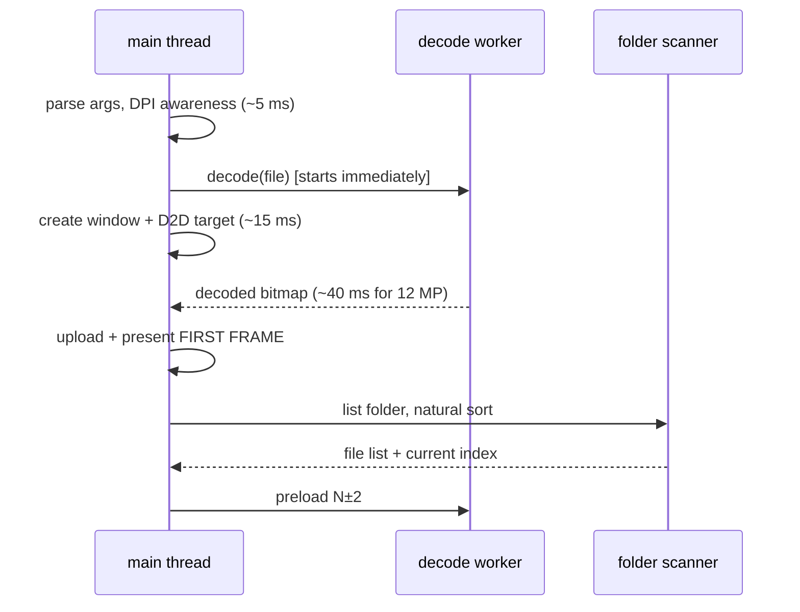

# kalux: Product Requirements Document

| | |
|---|---|
| **Product** | kalux, a fast native image viewer for Windows |
| **Family** | ka-suite: kavox (voice), kapix (snipping), kadex (notes), **kalux (photos)** |
| **Owner** | Ignatius Karel |
| **Status** | Draft v0.1 |
| **Date** | 2026-11-24 |
| **Language** | 100% Rust |

---

## 1. Summary

kalux replaces the **Windows 11 Photos** app as the default way to open images. It is a single small `.exe` that shows the image **almost as soon as you double-click it**, uses little RAM, and **leaves nothing running when closed**.

The name comes from *lux*, Latin for light, because photography is drawing with light.

## 2. Problem

The Windows 11 Photos app is built on WinUI 3 and the Windows App SDK. Users commonly report:

- **Slow cold start.** It often takes 1.5–4 s to show a single JPEG, because it also loads a gallery, cloud sync (OneDrive/iCloud) and AI editing features.
- **High memory.** Roughly 150–350 MB across its processes with one image open.
- **Large install.** Hundreds of MB including framework dependencies.
- **Background residency.** It can keep running after the window closes, or start with Windows.
- **Laggy navigation.** 100–400 ms before the next image shows when pressing ← / →.

Most people opening an image want to **look at it and flip to the next one**. They don't want a gallery or an AI editor.

> These figures are typical user reports, not controlled measurements. One of the first project tasks (M0) is to measure the Photos baseline on reference hardware.

## 3. Goals and non-goals

### Goals
1. **Instant open:** the first image is on screen within the budget in §5.
2. **Small footprint:** a single static `.exe` with no runtime to install and no WebView.
3. **Instant navigation:** previous/next feels immediate thanks to preloading.
4. **Native Windows feel:** dark mode, Mica/immersive title bar, per-monitor DPI and Default Apps integration.
5. **Zero residue:** nothing in the background, no telemetry, no account.

### Non-goals (v1)
- A gallery, library, albums, face recognition or timeline
- Cloud sync (OneDrive/iCloud)
- AI editing (erase, background removal, upscaling)
- Video playback or editing
- Full photo editing. kalux stays a viewer; annotation is handed off to **kapix** (§7.4).
- macOS or Linux (the architecture shouldn't block them, but they won't be tested)

## 4. Target users

| Persona | Need |
|---|---|
| **Everyday user** | Double-clicks a downloaded JPEG or screenshot and wants to see it right away |
| **Power user / dev** | Keyboard-driven, portable exe, sensible defaults, configurable |
| **Photographer (light)** | Quickly flips through a folder, checks EXIF, zooms to 100% for focus checks |
| **Low-end PC owner** | 4–8 GB RAM, HDD or eMMC; Photos is especially painful here |

## 5. Performance budgets (release blockers)

Reference machine: Windows 11 23H2+, 6-core CPU, NVMe SSD, integrated GPU, 12 MP JPEG (4000×3000), 1080p and 4K displays.

| Metric | Photos (baseline, est.) | **kalux target** | **kalux hard limit** |
|---|---|---|---|
| Cold start → first image | 1.5–4 s | **≤ 150 ms** | 300 ms |
| Warm start → first image | 0.7–1.5 s | **≤ 80 ms** | 150 ms |
| Next/prev (preloaded) | 100–400 ms | **≤ 16 ms** (1 frame) | 33 ms |
| Next/prev (not preloaded, 12 MP) | n/a | **≤ 80 ms** | 150 ms |
| Private RAM, 1 image open | 150–350 MB | **≤ 50 MB** | 80 MB |
| Private RAM, browsing (cache full) | n/a | **≤ 150 MB** | 250 MB |
| Binary size (stripped, release) | 150–400 MB install | **≤ 4 MB** | 8 MB |
| Idle CPU, window open | n/a | **0%** (event-driven) | < 0.5% |
| Resident after close | possibly | **0 processes** | 0 |

**Rule:** CI runs the benchmark suite (§10) on every PR. A regression of more than 10% on any metric fails the build.

## 6. Supported formats

| Tier | Formats | Decoder |
|---|---|---|
| **P0 (MVP)** | JPEG, PNG, GIF (animated), BMP, ICO, WebP | WIC (built into Windows, adds nothing to binary size); `zune-jpeg` fast path for JPEG |
| **P1** | HEIC/HEIF, AVIF, TIFF, JPEG XL | WIC when the Store codec extension is installed; otherwise show a clear message with a link to get it |
| **P2** | Camera RAW (CR2/CR3, NEF, ARW, DNG), SVG, PSD (flattened preview) | WIC RAW extension / embedded JPEG preview; `resvg` for SVG behind a cargo feature |

EXIF orientation is **always** respected. ICC color profiles are applied in v1.0 through WIC color contexts.

## 7. Features

### 7.1 MVP (v0.1): "open and flip"
- [ ] Open a file from the command line, double-click (file association) or drag-and-drop
- [ ] Borderless dark window; image is fit-to-window by default
- [ ] ← / → (and mouse side buttons) go to the previous/next image in the same folder, using natural sort order (`img2` before `img10`)
- [ ] Preload the next and previous images (N±2, configurable)
- [ ] Zoom: mouse wheel (zooming toward the cursor), `+` / `-`, `0` = fit, `1` = 100%
- [ ] Drag to pan when zoomed in
- [ ] Animated GIF/WebP playback
- [ ] `F11` / double-click = fullscreen, `Esc` = exit fullscreen, then close
- [ ] Title bar shows file name, index (12 / 340) and dimensions
- [ ] Per-monitor DPI v2 support and dark title bar

### 7.2 v0.2: "daily driver"
- [ ] Register in **Settings → Default apps** (installer and portable "register" command)
- [ ] Lossless rotate (`R` / `Shift+R`). Writes EXIF orientation; never re-encodes
- [ ] `Delete` sends the file to the Recycle Bin (with undo toast), then moves to the next image
- [ ] `Ctrl+C` copies the image (bitmap plus file) to the clipboard
- [ ] `Ctrl+Shift+C` copies the file path
- [ ] Info panel (`I`): EXIF data (camera, lens, ISO, shutter, aperture, date, GPS link), file size, format
- [ ] "Open containing folder" and "Open with…"
- [ ] Sort options: name, date modified, date taken, size
- [ ] Single-instance mode (optional): reuses the existing window through a named pipe

### 7.3 v1.0: "polish"
- [ ] ICC color management
- [ ] Filmstrip of thumbnails (toggle with `T`), drawn lazily from the Windows thumbnail cache (`IThumbnailCache`)
- [ ] Slideshow (`Space`) with an adjustable interval
- [ ] Set as desktop wallpaper
- [ ] Settings file (`%APPDATA%\kalux\config.toml`) plus a small settings window
- [ ] Remappable keybindings
- [ ] Localization groundwork (English and Bahasa Indonesia first)

### 7.4 ka-suite integration
- `E` → **Edit in kapix**: passes the current file to kapix for crop and annotation
- Shared visual language across ka-apps (colors, icon style, about dialog)
- Shared crate `ka-core` (later): window chrome, theming, config loading, single-instance IPC

## 8. UX principles
1. **The image is the UI.** No toolbars by default; controls fade in on mouse move and fade out after 1.5 s.
2. **Keyboard first.** Every action has a key; `?` shows a cheat sheet overlay.
3. **Never block the UI thread.** Decoding, folder listing and EXIF parsing happen on worker threads.
4. **No modal dialogs** for normal actions. Use toasts with undo.
5. **Fail clearly.** For unsupported or corrupt files, show the file name, the reason and the next step (for example, "Install HEIF extension").

### Default keymap
| Key | Action |
|---|---|
| ← → / PgUp PgDn / Mouse 4-5 | Previous / next |
| Home / End | First / last in folder |
| Wheel, `+` `-` | Zoom |
| `0` / `1` | Fit / 100% |
| `F11`, double-click | Fullscreen |
| `R` / `Shift+R` | Rotate CW / CCW (lossless) |
| `I` | Info panel |
| `T` | Filmstrip |
| `Space` | Slideshow |
| `Del` | Recycle |
| `Ctrl+C` | Copy image |
| `E` | Edit in kapix |
| `?` | Shortcuts overlay |
| `Esc` | Exit fullscreen, then close |

## 9. Technical architecture

### 9.1 Stack
| Concern | Choice | Why |
|---|---|---|
| Windowing / events | `windows-rs` raw Win32 (no winit) | Smallest binary, full control over title bar, DPI, Mica |
| First frame | **Direct2D** on an `ID2D1HwndRenderTarget` / DXGI swap chain | Ready in a few ms; no wait for a full GPU pipeline |
| Steady-state rendering | Direct2D + DirectComposition (same as the first frame) | One render path; GPU accelerated; good scaling quality. `wgpu` is only considered if custom shaders become necessary |
| Decoding | **WIC** via `windows-rs`; `zune-jpeg` fast path | WIC is free in binary size and supports codec extensions |
| EXIF | `kamadak-exif` (or WIC metadata query reader) | Pure Rust, small |
| Folder scan | `std::fs` + `natord` sort, on a worker thread | Doesn't block the first frame |
| Threading | `std::thread` + `crossbeam-channel` (no async runtime) | Less binary size and startup cost than tokio |
| Config | `serde` + `toml` (v1.0) | Standard |
| Errors / logs | `anyhow`, a small file logger behind `--log` | No cost when off |

### 9.2 Startup pipeline (critical path)



**Key idea:** decoding and window creation **run in parallel**, and folder scanning and preloading happen **after** the first frame.

### 9.3 Memory strategy
- Decoded images are uploaded to the GPU, then the CPU-side copy is dropped.
- Images larger than the display are downscaled by WIC at decode time (`IWICBitmapScaler` / JPEG DCT scaling). The full-resolution version is decoded only when zooming past fit.
- LRU cache sized by **bytes**, not item count (default 128 MB of GPU textures).
- Decode requests are cancelled when the user flips past them.

### 9.4 Binary size strategy
```toml
[profile.release]
opt-level = 3
lto = "fat"
codegen-units = 1
panic = "abort"
strip = true
```
- `-C target-feature=+crt-static` → single exe, no VC++ redistributable
- `#![windows_subsystem = "windows"]`
- Optional decoders (`svg`, `jxl-rs`) are behind cargo features and off by default
- `cargo bloat` runs in CI; the size budget is enforced

### 9.5 Repository layout
```
kalux/
├─ Cargo.toml
├─ crates/
│  ├─ kalux-core/       # image types, playlist + natural sort, view math, byte LRU, keymap (no deps)
│  ├─ kalux-decode/     # WIC + zune decoders, scaler, worker pool, preloading ImageStore
│  └─ kalux-app/        # kalux.exe: Win32 window, Direct2D, input, --bench-startup
├─ .github/workflows/   # CI: fmt, clippy, tests, size gate, startup bench on windows-latest
├─ installer/           # (v0.2) winget manifest, optional MSI/Inno script
└─ docs/PRD.md
```

## 10. Measurement and benchmarks

| Metric | Method |
|---|---|
| Time to first frame | `kalux --bench-startup <file>` logs a timestamp from `QueryPerformanceCounter` at process start and after the first `Present`. Baseline for Photos: screen recording at 240 fps |
| Cold start | Reboot (or `RAMMap` → Empty Standby List), then run 10×; report the median and p95 |
| RAM | `GetProcessMemoryInfo` → `PrivateUsage`, sampled 2 s after the first frame. Photos: all processes summed in Process Explorer |
| Navigation latency | Time from key press to `Present`, averaged over a 200-image folder |
| Binary size | Size of the release artifact |

Results are published in the README as a **kalux vs Photos** table with the hardware listed.

## 11. Distribution
- **Portable:** `kalux.exe` (zip) from GitHub Releases
- **winget:** `winget install IgnatiusKarel.kalux`
- **Installer (v0.2):** small Inno Setup or WiX MSI that registers file associations and the Default Apps capability
- **Code signing:** needed before v1.0 to avoid SmartScreen warnings (look at Azure Trusted Signing or SignPath for open source)
- **Updates:** no auto-updater in v1; a "check for update" link in the About dialog only
- **Privacy:** no telemetry, no network access except the user-triggered update check

## 12. Success metrics
- All P0 budgets in §5 met on the reference machine at v0.1
- Author uses kalux as the default viewer for 2 weeks without falling back to Photos
- v1.0: 500+ GitHub stars, listed on winget, at least one write-up comparing it with Photos

## 13. Risks and mitigations

| Risk | Impact | Mitigation |
|---|---|---|
| D3D/D2D device creation slow on some GPUs or drivers | Misses cold start budget | Fall back to WIC → GDI `StretchDIBits` for the first frame; measure on Intel iGPU, AMD and NVIDIA |
| HEIC/AVIF need Store codec extensions | "Can't open my iPhone photos" | Detect the missing codec and show a one-click link to the Store extension; consider the `libheif` feature flag later |
| Antivirus scanning slows the first launch of a new exe | Cold start noise | Code signing; document separately from the app's own startup cost |
| Huge images (100+ MP, panoramas) | RAM spike | Tiled decode/render above a threshold; downscaled preview first |
| Default Apps registration on Windows 11 is restrictive | Users can't easily set it as default | Register properly through `RegisteredApplications` + capabilities and open the Settings page directly (`ms-settings:defaultapps`) |
| Scope creep into an editor or gallery | Bloat, the problem kalux exists to fix | Non-goals in §3 are enforced; editing goes to kapix |

## 14. Milestones

| Milestone | Scope | Exit criteria |
|---|---|---|
| **M0: Baseline** (week 1) | Measure Photos on reference hardware; set up the bench harness | Baseline table committed |
| **M1: First pixel** (weeks 2–3) | Win32 window + WIC decode + D2D present | Cold start ≤ 150 ms on a 12 MP JPEG |
| **M2: v0.1 MVP** (weeks 4–6) | §7.1 complete | All P0 budgets pass in CI |
| **M3: v0.2 daily driver** (weeks 7–9) | §7.2 + installer + winget | Author dogfoods it as the default viewer |
| **M4: v1.0** (weeks 10–14) | §7.3, ICC, filmstrip, signing | Public release + benchmark write-up |

## 15. Open questions
1. ~~**License:** MIT/Apache-2.0 dual (Rust convention) or GPL?~~ **Decided: MIT**, same as Kapix.
2. **Single instance by default?** Faster for repeated opens, but different from what users expect from Photos.
3. **Rendering:** stay with D2D only, or move to `wgpu` later for shaders (HDR, sharpening)?
4. **`ka-core` shared crate:** extract it now with kapix/kadex, or after kalux v1?
5. **Windows 10 support:** keep it (Mica degrades to a solid color) or require Windows 11?
